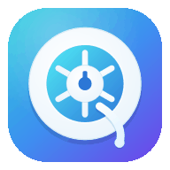
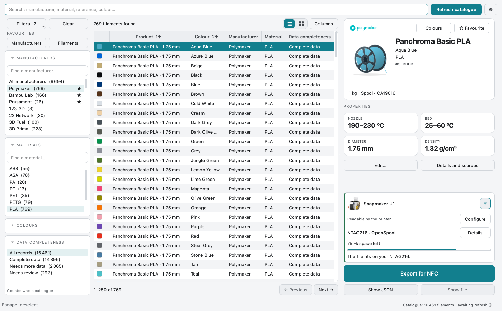
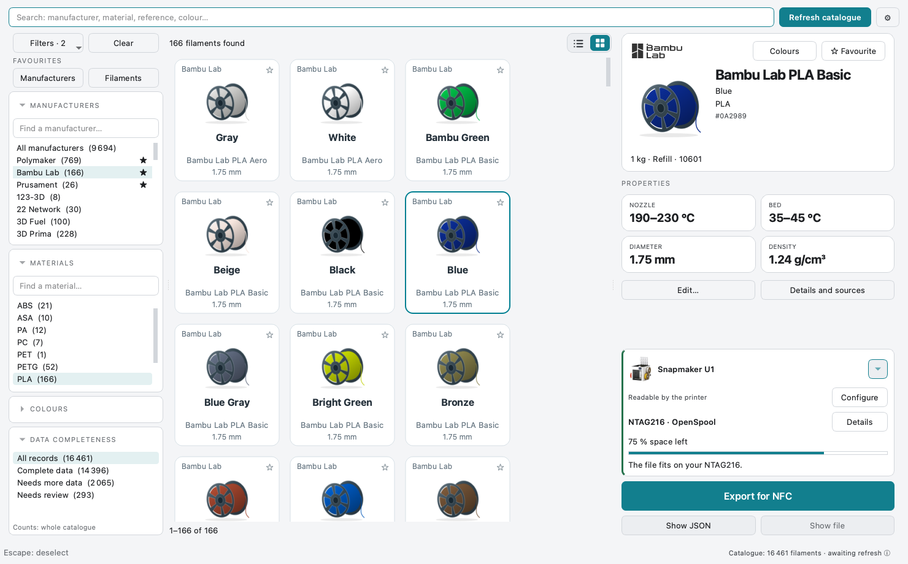

  

<h1 align="center">SpoolScribe v0.5.0 · Pre-release</h1>

<strong>Find your filament. Prepare its NFC label.</strong>

A filament catalogue for your desktop, with colour previews, OpenSpool and OpenTag3D exports. Windows · macOS · Linux — free, open source, no account.

  
  
  
  

<a href="#download">Download</a> · <a href="#your-first-tag">Your first tag</a> · <a href="#will-it-work-with-my-printer">Compatibility</a> · <a href="docs/README.md">Documentation</a>

Actual v0.5.0 interface, shown in English with public catalogue fixtures and temporary offline settings. Available in English, French, Spanish and Simplified Chinese.

**Current stable: [v0.3.5](https://github.com/ArN-LaB/Spoolscribe-/releases/tag/v0.3.5).**

**Try [v0.5.0 — Pre-release](https://github.com/ArN-LaB/Spoolscribe-/releases/tag/v0.5.0):**
Colour proximity search, in-card personal editing and a clearer hardware/export journey,
with OpenTag3D 2.004 alongside OpenSpool and NFC Tools profiles.
The downloads below are the pre-release builds; v0.3.5 remains the latest stable release.
[OpenTag3D guide](docs/OPENTAG3D.md) · [Printer and reader setups](docs/PRINTER-CONFIGURATIONS.md).

**Help verify real-world setups.** The v0.5.0 printer list describes documented
configurations, not a hardware-tested certification. Automated tests check the
software and exported data; testing every printer, reader and firmware combination
would require access to all of that equipment. Physical NFC writing and printer
read-back have not been validated by this project for these additions.
[Share a successful test or report a problem in Issues](https://github.com/ArN-LaB/Spoolscribe-/issues/new/choose)
with your printer model, reader, firmware/plugin versions, tag type, export format
and what happened. Your feedback will help improve the compatibility list and fix problems.

**SpoolScribe prepares the file.** A separate NFC writing app writes your NTAG215/216.
Use [SpoolFlux](https://spoolflux.dingdongclick.de/?lang=us) or another compatible writer
for OpenSpool JSON; import OpenTag3D profiles into the matching NFC Tools app.
Your printer or external reader must support the selected format and configuration.

**Interface languages:** English · Français · Español · 简体中文. The app follows your computer’s language, with English as the fallback. Override it in **Settings → Interface**. The app offers **Restart now** or **Later** after saving.

## Download

**v0.5.0 · Pre-release** — for testing the new colour search and guided editing/export experience.
Prefer a stable build? [Download v0.3.5](https://github.com/ArN-LaB/Spoolscribe-/releases/tag/v0.3.5).

No Python installation needed. Download, unzip and open the app for your system.

| System | Download | Checksum |
|---|---|---|
| **Windows 10 / 11 · x64** | [SpoolScribe.exe — ZIP](https://github.com/ArN-LaB/Spoolscribe-/releases/download/v0.5.0/SpoolScribe-windows.zip) | [SHA-256](https://github.com/ArN-LaB/Spoolscribe-/releases/download/v0.5.0/SpoolScribe-windows.zip.sha256) |
| **macOS · Apple Silicon** | [SpoolScribe.app — ZIP](https://github.com/ArN-LaB/Spoolscribe-/releases/download/v0.5.0/SpoolScribe-macos.zip) | [SHA-256](https://github.com/ArN-LaB/Spoolscribe-/releases/download/v0.5.0/SpoolScribe-macos.zip.sha256) |
| **Linux · x64** | [SpoolScribe — ZIP](https://github.com/ArN-LaB/Spoolscribe-/releases/download/v0.5.0/SpoolScribe-linux.zip) | [SHA-256](https://github.com/ArN-LaB/Spoolscribe-/releases/download/v0.5.0/SpoolScribe-linux.zip.sha256) |

[Pre-release notes](https://github.com/ArN-LaB/Spoolscribe-/releases/tag/v0.5.0) ·
[First-launch help](docs/wiki/Getting-Started.md) · [Run from source](docs/DEVELOPMENT.md)

<strong>First launch: macOS, Windows and Linux</strong>

- **macOS:** the bundle is signed ad hoc, without Apple notarisation. After verifying
  the download and its origin, right-click the app and choose **Open**. If Gatekeeper
  still blocks it, see the [installation guide](docs/wiki/Getting-Started.md).
  The supplied binary is for Apple Silicon, not Intel Macs.
- **Windows:** the executable has no commercial signing certificate. SmartScreen may
  ask for confirmation; verify its origin and SHA-256 before choosing **More info → Run anyway**.
- **Linux:** built on `ubuntu-latest`; requires a recent glibc and the Qt runtime
  libraries `libegl1`, `libxkbcommon0` and `libdbus-1-3`.

The `.zip.sha256` file contains the expected hash. Compare it with `sha256sum`
(Linux), `shasum -a 256` (macOS) or `Get-FileHash -Algorithm SHA256` (PowerShell).

## Less searching, more useful filament data

| Find the right filament | Make it yours | Prepare the tag |
|---|---|---|
| Search across manufacturers, materials and colours. Switch between list and grid. | Pin favourite manufacturers and filaments. Save your preferred spool size. | Choose your reader and NTAG215/216. Preview the file that gets exported. |
| Sort from the column headers and choose the columns you need. | Keep an independent `@Personal` copy of your adjustments through catalogue refreshes. | Check capacity before export, choose the destination folder and get a saved-file confirmation. |

The spool preview follows the recorded filament colour. Unknown colours stay unknown until you choose one.

## Your first tag

1. **Choose your sources.** On the first run, select the catalogue sources and click
   **Refresh now** (*Actualiser maintenant* in French). The app downloads its database after your consent.
2. **Find your filament.** Manufacturer and material filters narrow each other’s available choices. Search or filter, then select the colour and the actual
   spool size. Save a favourite if you use it often.
3. **Set up your hardware.** Open **My hardware** and choose your printer or
   reader, then compose its actual installation with the buttons and choose the tag you bought.
4. **Export and write.** Click **Export for NFC**, choose a folder, then use your
   NFC writer to write the file. Read the tag back and check it on your reader.

Your catalogue stays available offline after its first download. You can choose
which sources to refresh and how often. Preferences and personal filament copies
stay in your user folder.

## Will it work with my printer?

**An RFID/NFC reader does not by itself guarantee format compatibility.** The app's
**My hardware** selector explains what your setup can read.

| Your setup | What SpoolScribe provides |
|---|---|
| **Snapmaker U1 / paxx12, built-in Snapmaker detection** | OpenSpool files for NTAG215/216. Stock manufacturer firmware is a different setup. |
| **The same U1 / paxx12, OpenRFID or OpenRFID Generic** | OpenSpool or OpenTag3D. Generic changes brand handling, not the available formats. |
| **A documented USB or network integration** | Formats and prerequisites depend on the reader/plugin. External inventory and printer recognition are distinguished. |
| **Native Bambu AMS, Prusa OpenPrintTag and other unsupported formats** | A reference sheet; native/proprietary tags are not generated. An added reader is a separate configuration. |

[Printer and reader guide](docs/wiki/Printers-and-Readers.md) ·
[NFC formats explained](docs/FORMATS-NFC.md) · [Writing a tag](docs/wiki/Writing-RFID-Tags.md)

## Where does the catalogue come from?

Selected public sources include **Open Filament Database**, **SpoolmanDB**,
**Polymaker**, **Bambu Studio** profiles and **SUNLU** manufacturer information.
Coverage varies by source and is not exhaustive.

- **Your corrections come first**, then manufacturer values, then community data.
- Uncertain matches are kept aside; missing colours and physical values are not invented.
- Source identifiers are distinguished from manufacturer article numbers.
- The installer ships without a catalogue. Network access requires your consent;
  no personal catalogue is uploaded.

[Sources and licences](docs/DATA_SOURCES.md) · [Privacy](docs/PRIVACY.md)

<strong>For contributors: code, CLI and validation</strong>

The app uses Python and PySide6, with a shared core for the desktop and command-line
interfaces. See [development and CLI use](docs/DEVELOPMENT.md) and
[how to contribute](.github/CONTRIBUTING.md).

The suite contains **428 offline tests**, including five publication safety checks.
CI runs Linux/Python 3.10 and 3.12, Windows/Python 3.12 and macOS/Python 3.12 before
three native builds and their frozen-app, resource, TLS and export checks. See the
[validation record](docs/validation/v0.5.0.md) and its release workflow links.
These automated checks do not replace human desktop acceptance or physical NFC read-back.

## Help, ideas and the next steps

[Documentation](docs/README.md) · [FAQ](docs/wiki/FAQ.md) ·
[Report a bug](https://github.com/ArN-LaB/Spoolscribe-/issues/new/choose) ·
[Suggest an improvement](https://github.com/ArN-LaB/Spoolscribe-/issues/new/choose) ·
[Roadmap](docs/ROADMAP.md) · [Changelog](CHANGELOG.md)

Built by [ArN-LaB](https://github.com/ArN-LaB) in my free time. Free and open source,
with no paid features. If it helps you, feedback and contributions are welcome —
and you can [buy me a coffee](https://buymeacoffee.com/arn_lab) if you feel like it.

**MIT code** · [Licence](LICENSE) · [Attributions](NOTICE) · [Code of conduct](.github/CODE_OF_CONDUCT.md) · [Security](.github/SECURITY.md)

Data and brand artwork keep their own licences and trademark rights. SpoolScribe
is not affiliated with filament or printer manufacturers; see [trademarks](docs/TRADEMARKS.md).
Thanks to the public data projects, OpenSpool, compatible-reader projects and
independent NFC writers that make this workflow possible.
