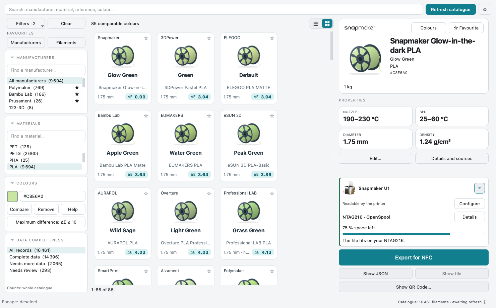
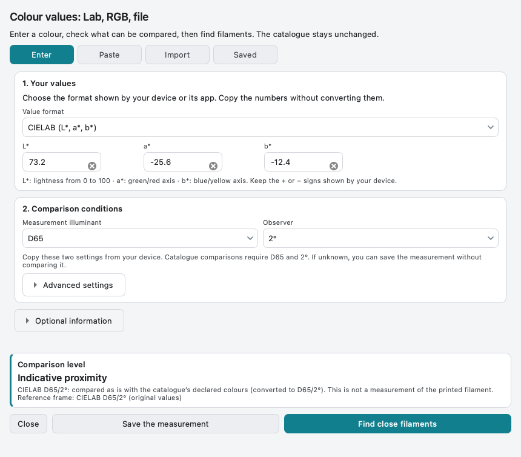
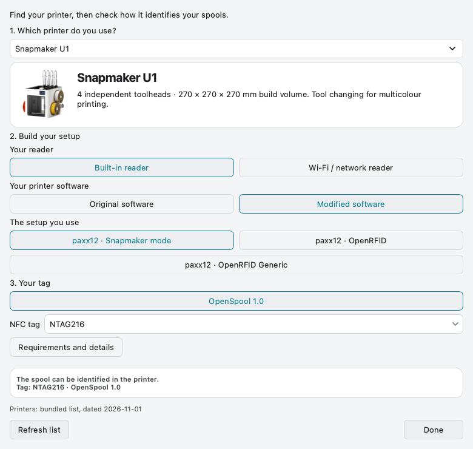
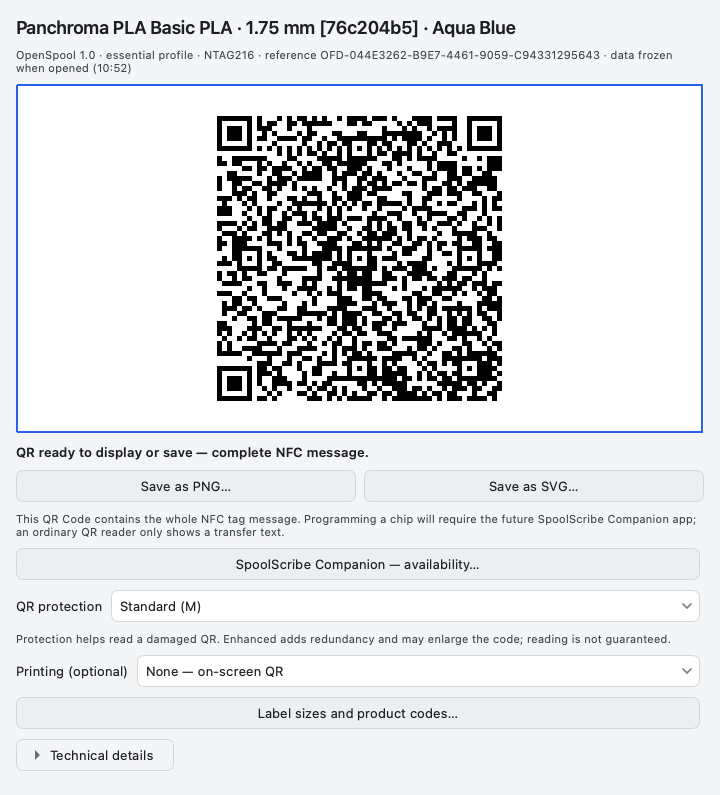

<h1 align="center">SpoolScribe v0.8.1</h1>

<strong>Find your filament. Prepare its NFC label.</strong>

Windows · macOS · Linux English · Français · Español · 简体中文

<a href="#download">Download</a> · <a href="https://github.com/ArN-LaB/Spoolscribe-/wiki/Getting-Started">Get started</a> · <a href="https://github.com/ArN-LaB/Spoolscribe-/wiki">Help centre</a> · <a href="docs/COMPANION.md">Companion</a>

A free desktop filament catalogue with visual colour matching, personal references,
**OpenSpool 1.0 / OpenTag3D 2.004 exports** and **offline SSQR1 QR transfer**.
No account. Your catalogue stays local after its first download.

  

<strong>Find and select a filament</strong> Actual v0.8.1 interface · public demonstration data.

## Download

**v0.8.1 is the current stable Desktop release.** Software stability and hardware
compatibility are separate: printer/reader setups are documented individually and
are not all physically tested. [Validation](docs/validation/v0.8.1.md) · [Compatibility](docs/COMPATIBILITY.md).

<table>
<thead><tr><th align="left">System</th><th align="left">Build</th><th align="left">Download</th><th align="left">Verify</th></tr></thead>
<tbody>
<tr><td>Windows</td><td>x86_64</td><td><a href="https://github.com/ArN-LaB/Spoolscribe-/releases/download/v0.8.1/SpoolScribe-windows.zip">ZIP · 62.5 MiB</a></td><td><a href="https://github.com/ArN-LaB/Spoolscribe-/releases/download/v0.8.1/SpoolScribe-windows.zip.sha256">SHA-256</a></td></tr>
<tr><td>macOS</td><td>Apple Silicon · arm64</td><td><a href="https://github.com/ArN-LaB/Spoolscribe-/releases/download/v0.8.1/SpoolScribe-macos.zip">ZIP · 52.1 MiB</a></td><td><a href="https://github.com/ArN-LaB/Spoolscribe-/releases/download/v0.8.1/SpoolScribe-macos.zip.sha256">SHA-256</a></td></tr>
<tr><td>Linux</td><td>x86_64</td><td><a href="https://github.com/ArN-LaB/Spoolscribe-/releases/download/v0.8.1/SpoolScribe-linux.zip">ZIP · 98.8 MiB</a></td><td><a href="https://github.com/ArN-LaB/Spoolscribe-/releases/download/v0.8.1/SpoolScribe-linux.zip.sha256">SHA-256</a></td></tr>
</tbody>
</table>

Unzip and open the application. No Python installation is needed.
The v0.8.1 macOS Apple Silicon archive is signed with Developer ID and notarised
by Apple and requires macOS 15.0 or later. Keep Gatekeeper enabled. Windows is not commercially signed. Linux
needs a recent glibc and Qt system libraries. Intel/universal2 is not provided.
[First-launch instructions](https://github.com/ArN-LaB/Spoolscribe-/wiki/Getting-Started) · [Build from source](docs/DEVELOPMENT.md).

## New in v0.8.1

Preview portable preferences before applying them. Six settings tabs bring refresh cadence, catalogue, export, interface and diagnostics choices together.

Create and review ZIP backups, restore deliberately and undo changes. Unresolved recovery conflicts stay visible; value provenance and shared printer configurations help explain what is being used. Unknown setups require explicit confirmation, and uncertain NFC exports remain blocked.

Diagnostics are optional and off by default. Preference JSON and backup ZIP files are **not encrypted**; AES-256-GCM remains future work.

[Backup & restore](docs/wiki/Backup-and-Restore.md) · [Settings](docs/wiki/Settings.md) · [Release notes](https://github.com/ArN-LaB/Spoolscribe-/releases/tag/v0.8.1).

## Find the right reference

1. Select your catalogue sources and refresh after giving network permission.
2. Choose a manufacturer and material: each filter narrows the other.
3. Select the colour and the actual spool size. Pin useful favourites.
4. Keep your adjustments in a personal copy; source refreshes preserve it.

  

<strong>See the colour and spool size</strong> Switch between list and grid without losing your selection.

[Filaments, filters, columns and favourites](docs/wiki/Filaments-and-Favourites.md).

## Compare colours

Enter a HEX code or choose a swatch, then **Compare**. A smaller **ΔE** means
closer declared screen colours. The limit **ΔE ≤ 10** is a maximum distance,
not a percentage. Effects, transparency and printing can change the real result.

  

<strong>Find nearby colours</strong> The same ΔE values are available in list view.

Have Lab/RGB values or a file instead? Open **Lab, RGB or file…** to enter values,
interpret labelled text or review CSV/TSV columns. Save references and explicitly
reuse device entry settings without altering catalogue colours.

  

<strong>Use documented colour values</strong> CIELAB needs documented D65 and 2° conditions for catalogue comparison.

[Colour entry, files and saved references](docs/wiki/Measuring-Colours.md).

## Choose the real printer setup

Select the model, then the reader and software actually installed. The result
explains what the configuration can read. A USB reader alone is not proof that
the printer firmware accepts a format.

  

<strong>Check the reader and software</strong> Compatibility depends on the complete setup.

[Printer setup help](docs/wiki/Printers-and-Readers.md).

## Take the label to Companion

**Show QR Code — SpoolScribe Companion** displays the complete NFC message in an
offline QR. Save PNG or SVG, or keep it on screen. The QR contains data, not a
website or an App Store link.

  

<strong>Transfer the complete NFC message</strong> Companion mobile downloads are not yet available.

**SpoolScribe Companion is being developed for mobile use.** Official iOS and
Android links will appear on the [shared availability page](docs/COMPANION.md).
Until then, use a writer compatible with the chosen OpenSpool JSON or OpenTag3D
NDEF file. Desktop does not write the physical NFC tag.

A generic scanner can read SSQR1 text. QR error correction repairs damaged data;
it does not restrict scanning to Companion. [QR help](docs/wiki/Companion-and-QR.md)
explains the distinction and the future app-link path.

## Help, privacy and feedback

| Need | Start here |
| --- | --- |
| Learn each screen | [Illustrated help centre](docs/wiki/Home.md) |
| Select labels or paper | [Product codes and manufacturer templates](docs/PRINTING_GUIDE.md) |
| Understand stored data | [Desktop privacy](docs/PRIVACY.md) · [Data sources](docs/DATA_SOURCES.md) |
| Find mobile support and policy information | [Companion availability](docs/COMPANION.md) · [Companion support](https://arn-lab.github.io/Spoolscribe-/support/) · [Companion privacy](https://arn-lab.github.io/Spoolscribe-/privacy/) |
| Check software validation | [v0.8.1 evidence](docs/validation/v0.8.1.md) |
| Report a problem or a working setup | [Issues](https://github.com/ArN-LaB/Spoolscribe-/issues/new/choose) |
| Contribute or support development | [Contributing](.github/CONTRIBUTING.md) · [Buy Me a Coffee](https://buymeacoffee.com/arn_lab) |

Report the model, reader, firmware/plugin, tag type and format when sharing a
hardware result. Software CI is not a certification of every listed printer.
**The v0.8.1 release passed 824 offline tests per CI configuration**; its three native builds also exercised catalogue/NFC, colour entry and independent digital QR decoding.

SpoolScribe is independent of printer and filament manufacturers. Code: MIT.
Data licences and artwork credits: [NOTICE](NOTICE) · [Trademarks](docs/TRADEMARKS.md).
