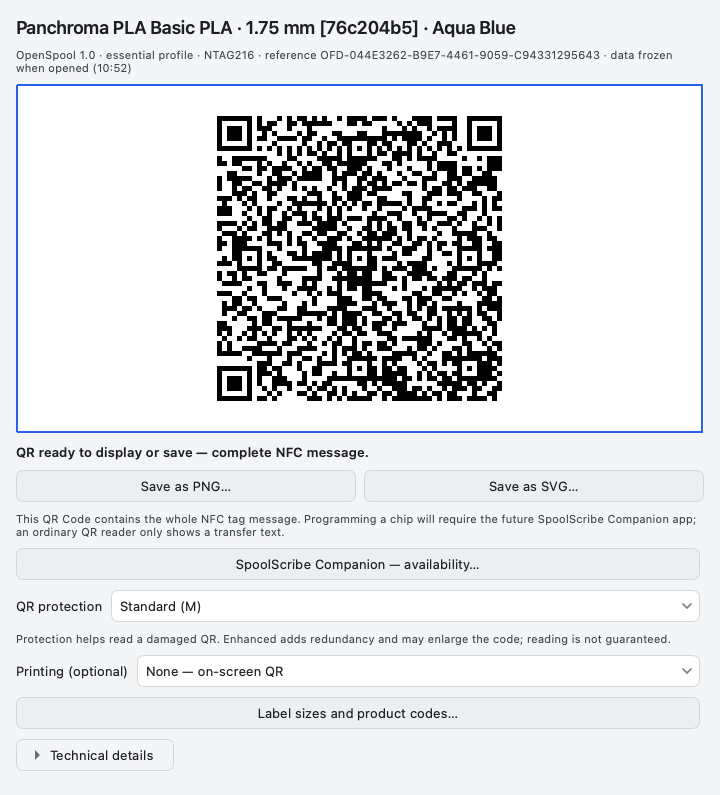
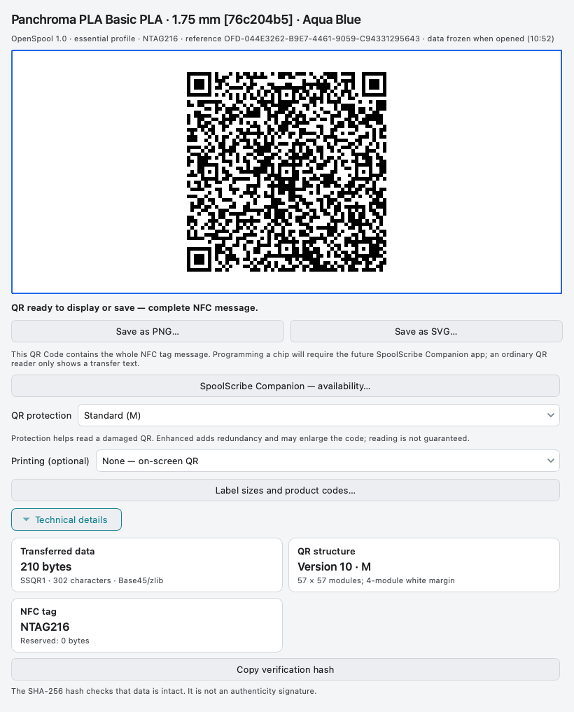
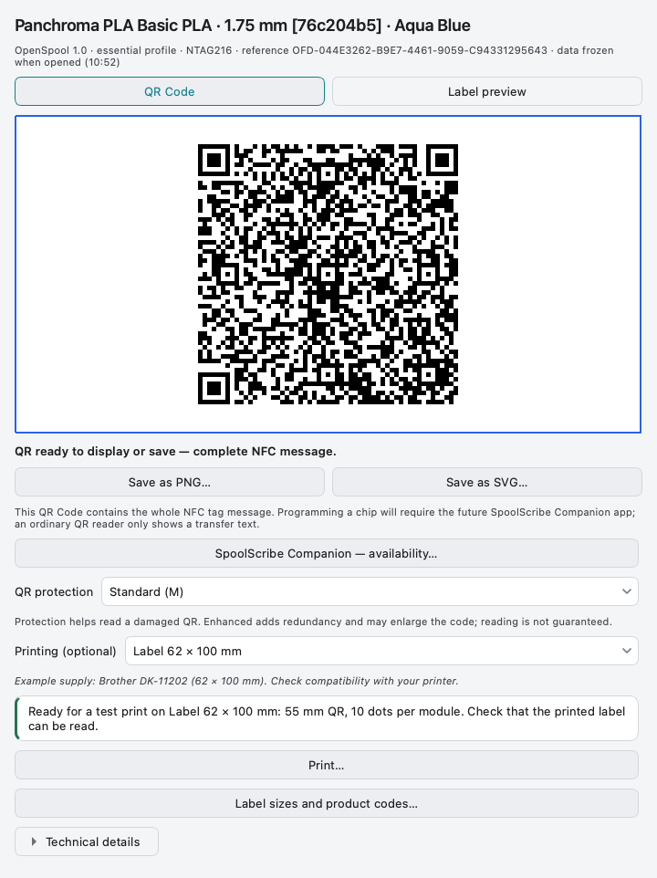
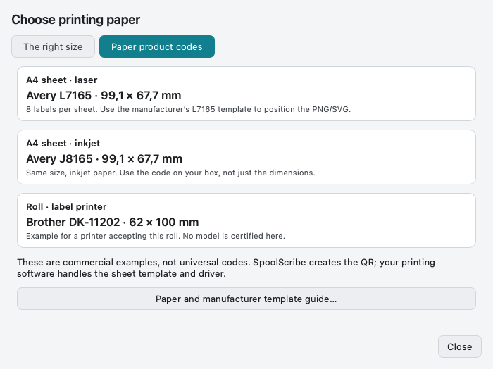

# Companion and the offline QR

[Help home](Home.md) · [Prepare a label](Writing-RFID-Tags.md) · [Paper guide](https://github.com/ArN-LaB/Spoolscribe-/blob/main/docs/PRINTING_GUIDE.md)

## Display now, scan with Companion when available

1. Select a filament and the actual NFC format/tag.
2. Complete any missing values before opening the QR.
3. Click **Show QR Code — SpoolScribe Companion**.
4. Keep it on screen, save PNG or save SVG. No server or paper is required.

  

<strong>Carry the complete NFC message</strong> The QR is frozen when the window opens.

The QR contains **SSQR1 text wrapping the complete NFC message**. Reopen it after
changing the filament or export settings. Screen zoom does not change its contents.
[iOS / Android availability](https://github.com/ArN-LaB/Spoolscribe-/blob/main/docs/COMPANION.md): official mobile
links will appear there; none is invented in this documentation.

## Does scanning force Companion to open?

**No.** A generic QR scanner can read the transfer text. The recommended future
journey is to open **Companion’s own scanner**, which must recognise and validate
SSQR1 before proposing a tag write. Desktop cannot force another app to close or
prevent it from reading visible QR data.

| Mechanism | Purpose | What it does not do |
| --- | --- | --- |
| QR protection M/Q | Helps recover damaged symbol data | Does not select an app or encrypt the payload |
| SSQR1 prefix and bounded decoder | Identifies and validates the transfer contract | Does not make the data private |
| SHA-256 integrity | Detects a changed message | Is not an authenticity signature |
| Future verified app links | Can route a supported URL to the installed app | Requires a controlled domain and mobile app configuration; not present in SSQR1 v1 |

A future Universal Links/App Links route is separate work. The current offline
SSQR1 contract is unchanged; no website or store link is inserted into these QR codes.
Sources: [DENSO WAVE](https://www.qrcode.com/en/about/error_correction.html),
[Apple associated domains](https://developer.apple.com/documentation/xcode/supporting-associated-domains),
[Android App Links](https://developer.android.com/training/app-links), consulted 5 November 2026.

## Choose protection and read the details

**Standard (M)** keeps the code less dense. **Reinforced (Q)** adds redundancy
and can enlarge it. Neither guarantees physical reading. Technical cards show
message size, symbol geometry, NFC capacity and a copyable integrity digest.

  

<strong>Inspect the technical facts</strong> These details describe data and geometry, not a hardware certification.

## Print only if useful

Leave **None — QR on screen** for a digital transfer. If printing, choose the
real support dimensions. The geometry check considers resolution, margins and
whole printer dots per QR module. Read the printed result before using it.

  

<strong>Choose paper only when needed</strong> A passing geometry check is not a scan guarantee.

  

<strong>Use the code on your box</strong> Commercial examples are not universal label standards.

[Product references and external sheet templates](https://github.com/ArN-LaB/Spoolscribe-/blob/main/docs/PRINTING_GUIDE.md).
The Desktop app creates the QR; a label-sheet template and printer driver stay
in your printing software. [SSQR1 specification](https://github.com/ArN-LaB/Spoolscribe-/blob/main/docs/QR_FORMAT.md).
