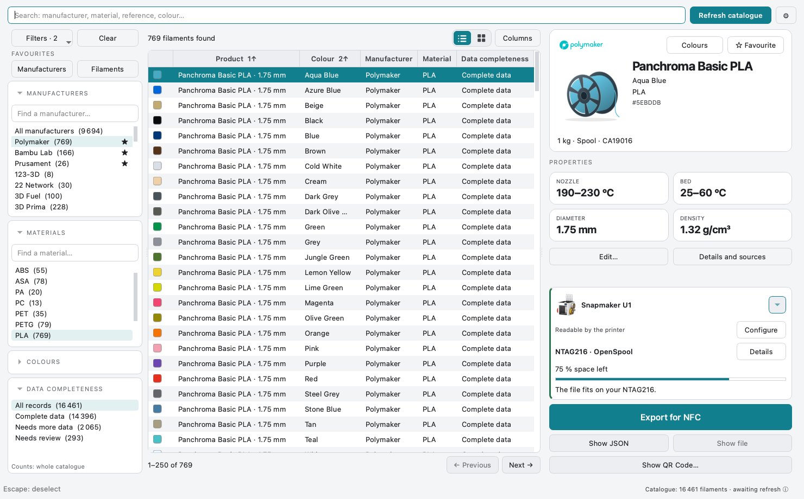
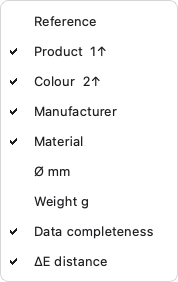
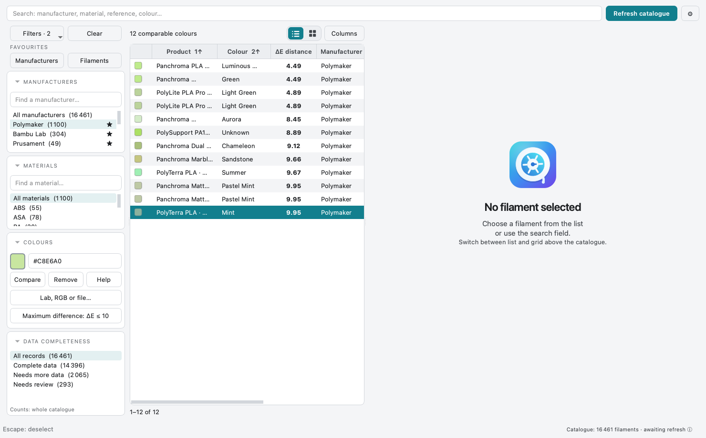
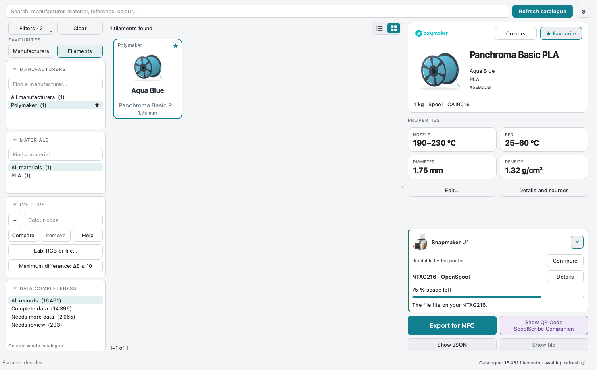
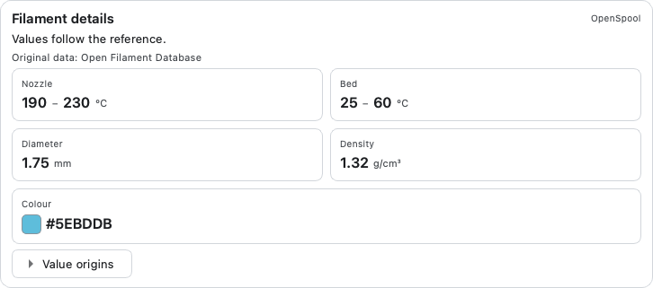
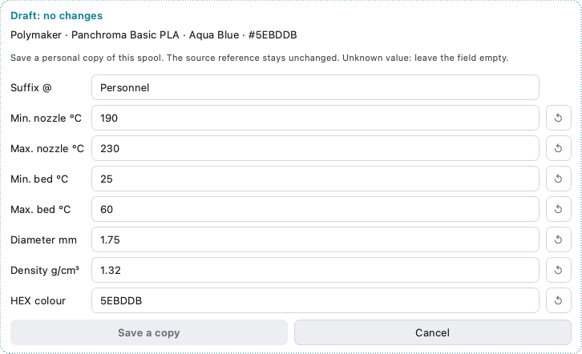

# Filaments, filters and favourites

[Help home](Home.md) · [Colour search](Measuring-Colours.md) · [Export](Writing-RFID-Tags.md)

## Find the correct spool

1. Type part of a manufacturer, product, reference or colour in the main search.
2. Narrow the manufacturer and material. The lists show only compatible choices.
3. Select the colour and the actual spool size. Similar names can describe different product lines.
4. Read the selected card before preparing a label.

  

<strong>Narrow the catalogue</strong> Manufacturer and material filters work together.

**Data completeness** describes the record, not filament quality. Missing or
conflicting values may require a choice before export. Do not guess an unknown HEX.

## Choose columns and sort

Click a column header to reverse ascending/descending order. The secondary-click
menu assigns the first or second sort key. **Columns** chooses visible fields.
When colour comparison is active, the dedicated **ΔE** column appears automatically.

  

<strong>Choose useful columns</strong> Column choices belong to the list view.

  

<strong>Read the same colour distance</strong> ΔE disappears when comparison is removed.

## Keep favourites without losing them

Use the star to save a manufacturer or filament. The two **Favourites** buttons
filter the view; they do not change which items are saved. **Clear** removes the
favourites-only view while keeping the stars. Removing a favourite is a separate action.

  

<strong>Show saved filaments</strong> Favourite manufacturers and filaments are separate choices.

## Inspect a value, or create your own copy

**Details and sources** shows the values actually used and their provenance.
**Edit…** opens an independent personal-copy draft. Keep a meaningful suffix such
as `@U1`; save the copy or cancel it. The source reference is not overwritten.
Updates keep personal copies. Opening one section closes the other for a clearer view.

  

<strong>Read where values come from</strong> Only differing values need a detailed comparison.

  

<strong>Save a personal reference</strong> A draft does not change the source catalogue.

Your preferred spool mass and spool/refill choice are in [Settings](Settings.md).
They are preselected only when an actual matching option exists. Settings can be
exported/imported separately from the filament catalogue and colour registry.
