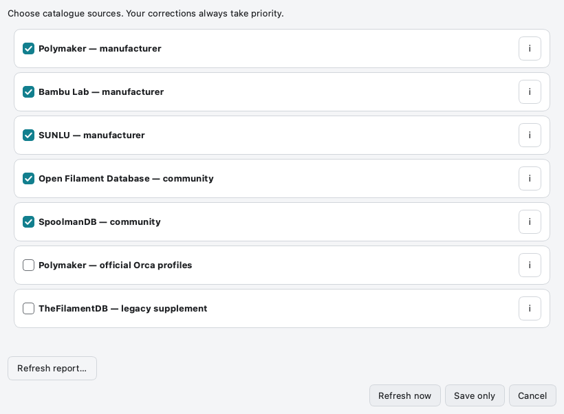
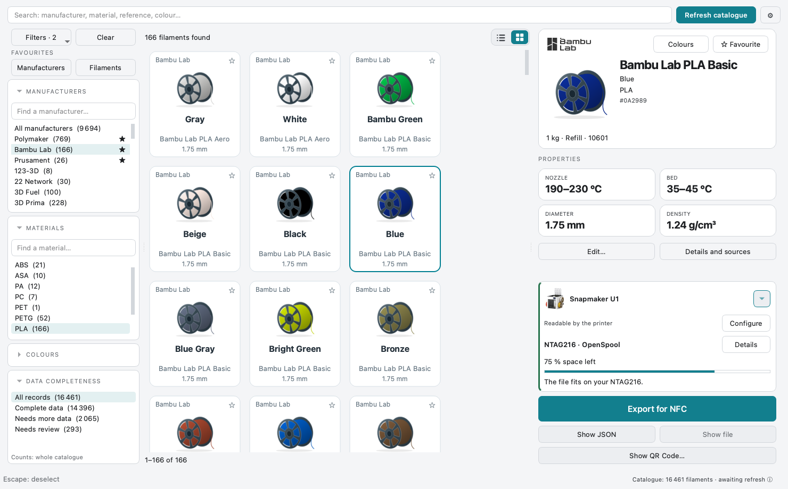

# Getting started

[Help home](Home.md) · [Filaments](Filaments-and-Favourites.md) · [Troubleshooting](FAQ.md)

## 1. Download and open

Download [v0.8.0 stable](https://github.com/ArN-LaB/Spoolscribe-/releases/tag/v0.8.0), then unzip the file for your
system. Windows contains `SpoolScribe.exe`, macOS contains `SpoolScribe.app`,
Linux contains `SpoolScribe`. Use the whole macOS bundle.

| System | First-launch notes |
| --- | --- |
| macOS Apple Silicon | Verify the SHA-256 and origin. The app is signed ad hoc, without Apple notarisation. Use macOS’s per-app Open action if prompted; keep global security enabled. Intel Macs need a source build. |
| Windows x64 | Verify origin and SHA-256. SmartScreen may warn because there is no commercial signing certificate. |
| Linux x64 | A recent glibc plus Qt EGL/XKB/DBus libraries are required. See the [runtime dependencies](https://github.com/ArN-LaB/Spoolscribe-/blob/main/docs/DEVELOPMENT.md#linux-desktop-runtime). |

Compare the ZIP with its `.sha256` file: `shasum -a 256` on macOS,
`sha256sum` on Linux, `Get-FileHash -Algorithm SHA256` in PowerShell.

## 2. Build the catalogue

The installer contains **no filament database**. Choose sources and click
**Refresh now**. This downloads public data after your permission. Do not expect
search results before the first successful refresh. Afterwards the cache works offline.

  

<strong>Choose the data to download</strong> Unchecking a source keeps records already downloaded.

If a source fails, keep the existing catalogue and consult the update report.
Do not repeatedly reinstall the application to fix a remote-source outage.
[Update help](Updating-the-Database.md).

## 3. Find your filament

Choose a manufacturer, then a material or a search term. Select the colour and
spool size from your own bobbin. The right-hand card shows the selected reference.

  

<strong>Select a filament</strong> Check colour, product range and actual spool size.

The manufacturer and material filters narrow each other. **Clear** resets the
active filters and favourites-only views; it does **not** delete saved favourites.
Click the selected row again or press Escape to deselect it.

## 4. Prepare the destination

Open the hardware settings and select the real printer/reader/software setup.
Then choose the tag you bought. The selected format must be readable by that setup.
[Configure your hardware](Printers-and-Readers.md).

Use **Export for NFC** for a compatible writing application, or **Show QR Code —
SpoolScribe Companion** for an offline transfer. [QR and Companion](Companion-and-QR.md).
Desktop does not write the tag or prove the printer read it successfully.
