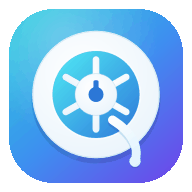
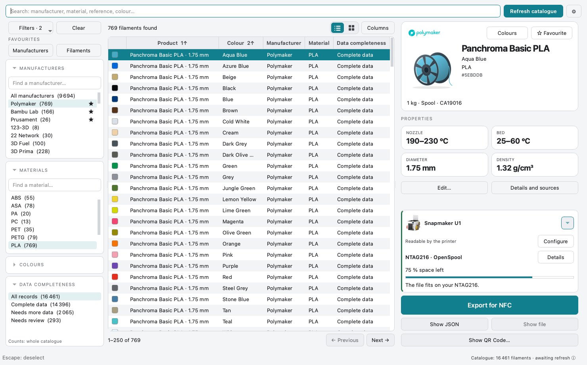
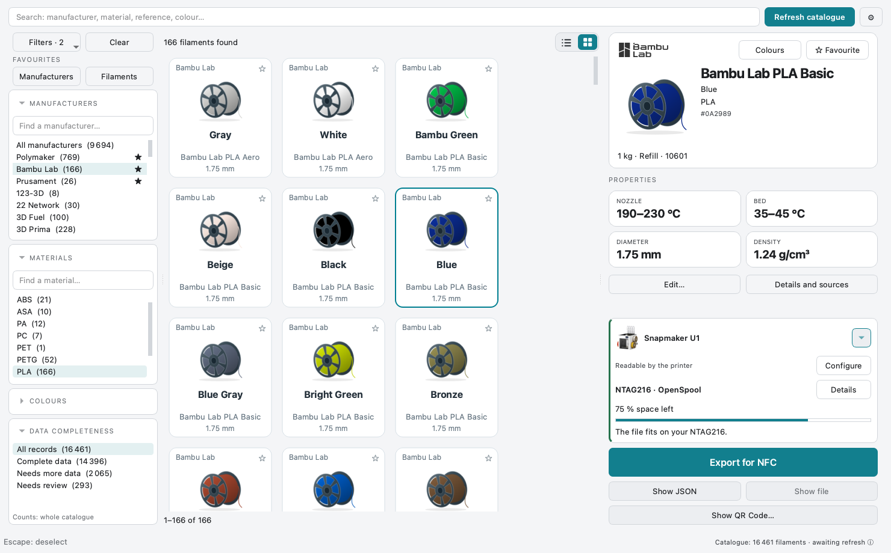
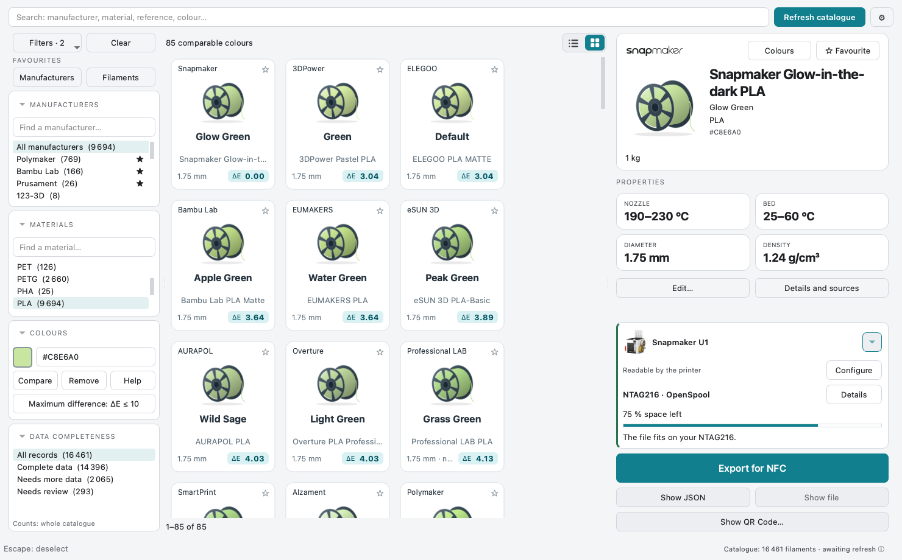
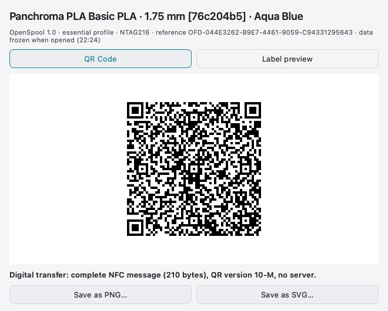

  

<h1 align="center">SpoolScribe v0.7.0 · Pre-release</h1>

<strong>Find your filament. Prepare its NFC label.</strong>

Your desktop filament catalogue, with OpenSpool and OpenTag3D exports. Windows · macOS · Linux — free, open source, no account.

  
  
  

<a href="https://github.com/ArN-LaB/Spoolscribe-/wiki/Getting-Started">Start here</a> · <a href="https://github.com/ArN-LaB/Spoolscribe-/wiki/Printers-and-Readers">Check your printer</a> · <a href="https://github.com/ArN-LaB/Spoolscribe-/wiki/FAQ">Get help</a>

Actual v0.6.0 interface, shown in English using public catalogue fixtures and isolated offline settings. Counts are demonstration data, not live coverage.

## A catalogue that works your way

| Find it | Make it yours | Prepare the label |
| --- | --- | --- |
| Search manufacturers, materials, colours and references. Filters narrow each other. | Save favourites, choose your usual spool size and keep a personal <code>@copy</code>. | Choose a compatible reader and NTAG215/216. Preview the file and export it to your folder. |
| [Explore the catalogue](Getting-Started.md#3-find-your-filament) | [Personal copies and favourites](FAQ.md#your-catalogue) | [Write your first tag](Writing-RFID-Tags.md) |

## Your first label, in four steps

| 1. Download | 2. Find | 3. Configure | 4. Export & write |
| --- | --- | --- | --- |
| Open the app and download your selected sources after consent. | Select the filament, shade and actual spool size. | Choose your printer or reader, installed software and tag. | Export the file; use the matching NFC writer, then read the tag back. |

**SpoolScribe prepares the file.** A separate writing app programs the tag.
Choose your actual reader/software setup and eligible format. An RFID/NFC reader
alone does not guarantee OpenSpool or OpenTag3D compatibility.
[Check your setup before buying tags](Printers-and-Readers.md)

Switch between list and grid. The spool preview follows the recorded HEX; missing colours are never invented.

**New in v0.6.0:** digital SSQR1 QR transfer (PNG/SVG) for the future Companion.
[How it works](Writing-RFID-Tags.md#digital-qr-transfer-ssqr1-v060-pre-release).
Printing and physical acceptance are deferred; Companion is not implemented yet.

## New in v0.7.0: keep your own colour references

Enter HEX/RGB/CIELAB, paste labelled values or map a CSV/TSV. Save original values
and conditions in a separate local registry; use eligible measurements as an
**indicative** colour target without changing catalogue colours.
[Measure or import a colour](Measuring-Colours.md). No instrument driver or SDK.

## See the useful details

| Compare a colour | Carry the NFC message |
| --- | --- |
|  |  |
| Smaller ΔE means closer declared screen colours. Set an inclusive maximum; it is not a percentage. | Save PNG/SVG for the future Companion. No server; printing and physical acceptance are deferred. |

**[Walk through all six v0.6.0 captures](Visual-Tour.md)** — list, grid, ΔE,
photographic printer selection, hardware choices and digital QR.

## Download v0.7.0 · Pre-release

Try colour proximity search, in-card personal editing and the clearer hardware/export journey. [v0.3.5 remains the latest stable](https://github.com/ArN-LaB/Spoolscribe-/releases/tag/v0.3.5).

No Python installation needed. Download the ZIP for your system and its checksum.

| Platform | Application | SHA-256 |
| --- | --- | --- |
| **Windows 10 / 11 · x64** | [Download ZIP](https://github.com/ArN-LaB/Spoolscribe-/releases/download/v0.7.0/SpoolScribe-windows.zip) | [Checksum](https://github.com/ArN-LaB/Spoolscribe-/releases/download/v0.7.0/SpoolScribe-windows.zip.sha256) |
| **macOS · Apple Silicon** | [Download ZIP](https://github.com/ArN-LaB/Spoolscribe-/releases/download/v0.7.0/SpoolScribe-macos.zip) | [Checksum](https://github.com/ArN-LaB/Spoolscribe-/releases/download/v0.7.0/SpoolScribe-macos.zip.sha256) |
| **Linux · x64** | [Download ZIP](https://github.com/ArN-LaB/Spoolscribe-/releases/download/v0.7.0/SpoolScribe-linux.zip) | [Checksum](https://github.com/ArN-LaB/Spoolscribe-/releases/download/v0.7.0/SpoolScribe-linux.zip.sha256) |

[First-launch help](Getting-Started.md#1-download-and-open) · [Pre-release notes](https://github.com/ArN-LaB/Spoolscribe-/releases/tag/v0.7.0)

**English · Français · Español · 简体中文** — the app follows your computer’s language,
with English as the fallback. Change it in **Settings → Interface** and restart
when prompted.

## Pick your next guide

| Start using the app | Understand your hardware | Keep your catalogue healthy |
| --- | --- | --- |
| [Getting started](Getting-Started.md) Install, search, personalise and export. | [Printers & readers](Printers-and-Readers.md) OpenSpool, OpenTag3D and other RFID formats. | [Catalogue updates](Updating-the-Database.md) Sources, refresh results and backups. |
| [Writing RFID tags](Writing-RFID-Tags.md) NTAG215/216, capacity and read-back. | [Snapmaker U1 & paxx12](Snapmaker-U1-and-paxx12.md) The U1 workflow and its limits. | [Frequently asked questions](FAQ.md) Personal copies, missing data and troubleshooting. |

<strong>Sources, privacy and validation</strong>

The catalogue is not exhaustive. Your corrections take priority, followed by
manufacturer facts and then community values. Missing values stay unknown;
uncertain matches are held aside. The installer contains no catalogue.

[Sources and licences](https://github.com/ArN-LaB/Spoolscribe-/blob/main/docs/DATA_SOURCES.md) ·
[Privacy](https://github.com/ArN-LaB/Spoolscribe-/blob/main/docs/PRIVACY.md) ·
[Release validation](https://github.com/ArN-LaB/Spoolscribe-/blob/main/docs/validation/v0.7.0.md)

Publication requires four CI test configurations and three native builds to pass. Automated validation
does not mean physical NFC acceptance has been performed on every printer/reader
combination. [Share a successful test or a problem](https://github.com/ArN-LaB/Spoolscribe-/issues/new?template=printer_compatibility.yml).
Screenshots are direct application captures, not mockups or successful live refreshes.
[Image provenance](https://github.com/ArN-LaB/Spoolscribe-/blob/main/docs/images/README.md).

## Help shape SpoolScribe

[Report a bug or suggest an idea](https://github.com/ArN-LaB/Spoolscribe-/issues/new/choose) ·
[Roadmap](https://github.com/ArN-LaB/Spoolscribe-/blob/main/docs/ROADMAP.md) ·
[Source code](https://github.com/ArN-LaB/Spoolscribe-)

Built by ArN-LaB in my free time. Feedback and contributions are welcome.

SpoolScribe is an unofficial project, unaffiliated with printer or filament manufacturers.
[Licences and trademarks](https://github.com/ArN-LaB/Spoolscribe-/blob/main/docs/TRADEMARKS.md).
