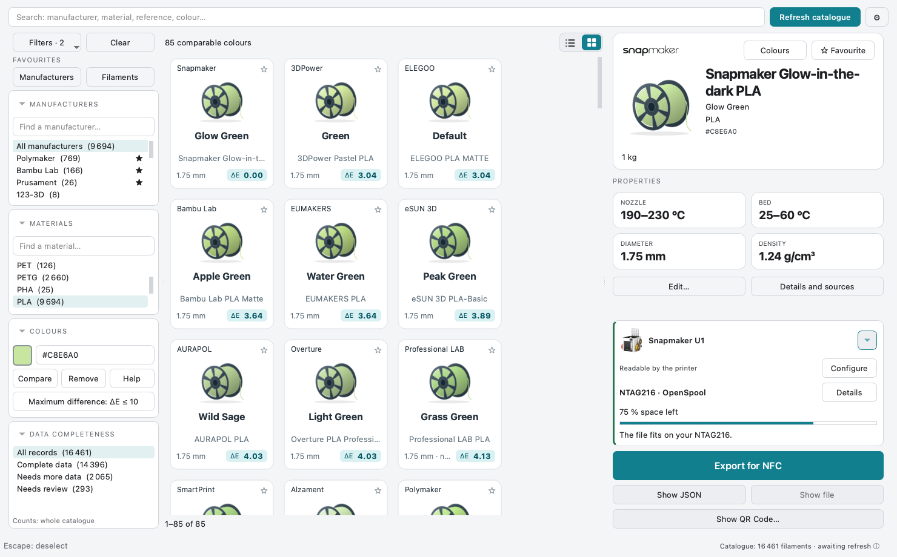
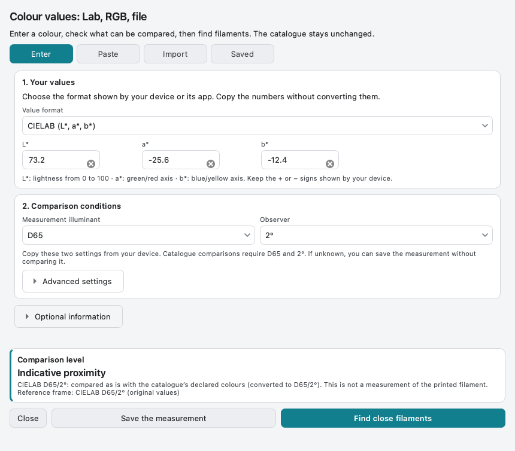
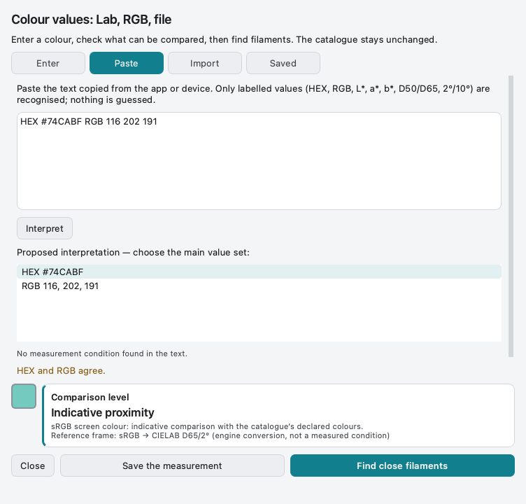
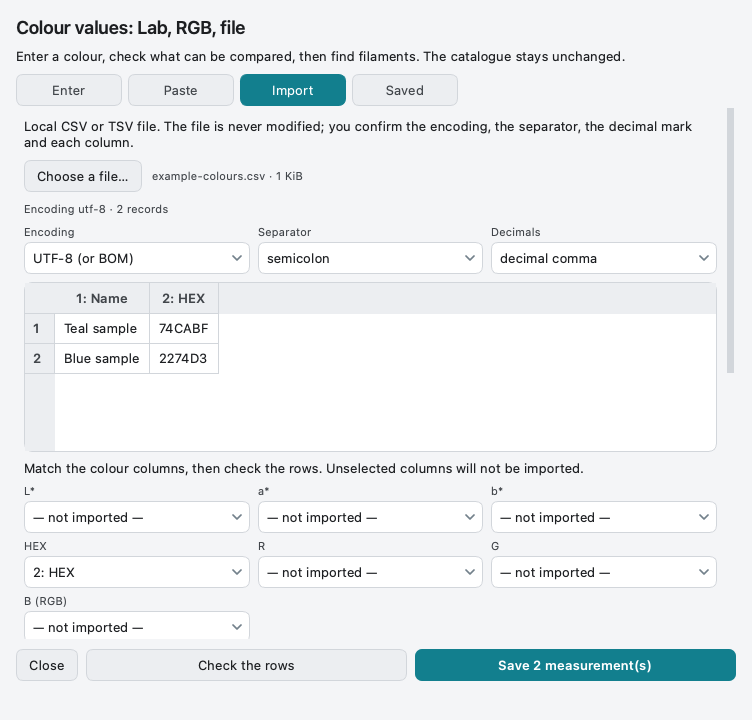
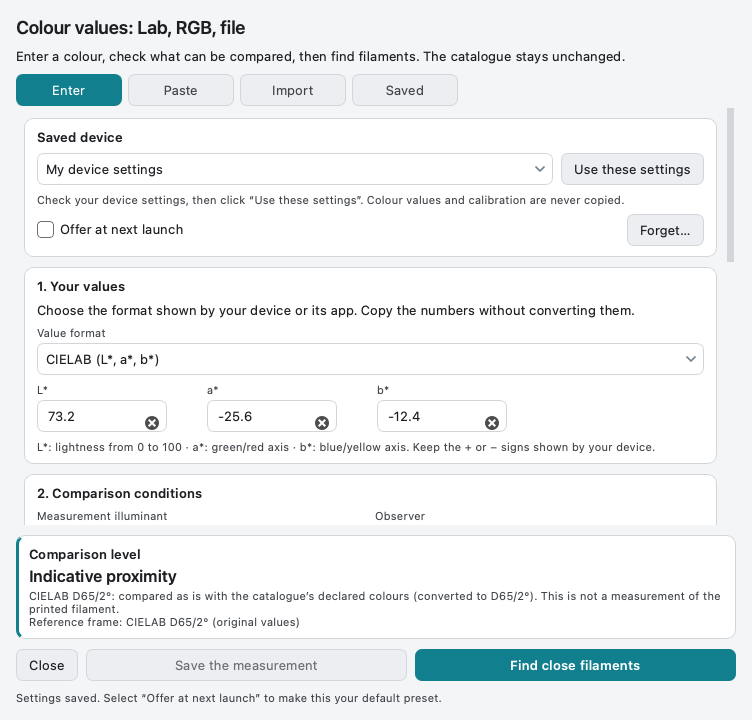
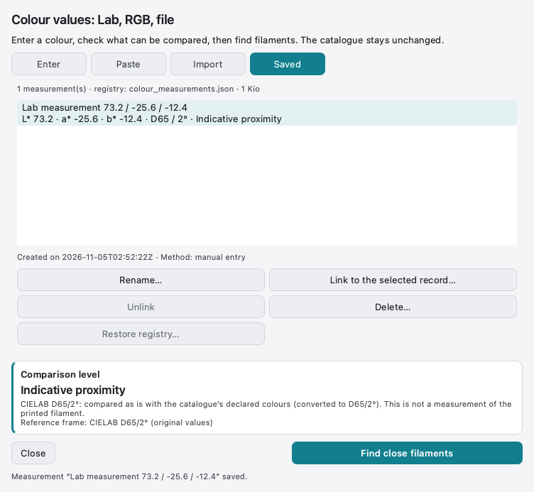

# Find a filament from colour values

[Help home](Home.md) · [Filaments](Filaments-and-Favourites.md) · [Settings](Settings.md)

## Start with a HEX code

Enter a code or pick a swatch in **Colours**, then click **Compare**. Your other
filters still apply. The closest declared catalogue colours appear first.

  

<strong>Compare declared screen colours</strong> A smaller ΔE means a closer match.

**Maximum ΔE 3** means **ΔE ≤ 3**, not “around 3” or a percentage. A value 3.04
is excluded at 3 and included at 10. Displayed distances are rounded upward to
the hundredth; the threshold uses the calculated value. Effects, gloss and
transparency can change the printed result. **Remove** clears the colour comparison.
Change the limit through **Maximum difference** or **Settings → Colours**.

## Use Lab, RGB or a file

The **Lab, RGB or file…** button is for values copied from another application,
a document or a measuring device. Desktop does not control a device or take a measurement.

| Your values | Choose | What to check |
| --- | --- | --- |
| HEX or RGB | sRGB HEX or 8-bit RGB | RGB uses integers 0–255. Do not enter Display P3/Adobe RGB as sRGB. |
| L*, a*, b* | CIELAB | Copy the illuminant and observer from the source. Do not guess them. |
| Text copied from an application | Paste | Review the interpreted set. Editing the text invalidates the previous interpretation. |
| CSV/TSV file | Import | Confirm encoding, separator, decimals and mapped columns before saving. |

  

<strong>Enter documented Lab values</strong> D65 and 2° are required for indicative catalogue comparison.

Unknown conditions, D50 or 10° can be **saved**, but cannot be ranked against the
catalogue. D65/2° is not inferred from a device’s name. Optional sample information
helps you recognise an entry later; it does not turn a declared HEX into a physical measurement.

  

<strong>Review copied values</strong> Choose the intended set before saving or searching.

  

<strong>Check a file before import</strong> The input file is never modified.

## Reuse device entry settings explicitly

Under optional information, record the device and documented conditions, then
**Save these settings…**. At a later entry, select the preset and click **Use these
settings**. A default only proposes the preset: it does not silently apply it.
Calibration, sample preparation, date and colour coordinates are never reused.

  

<strong>Remember entry settings</strong> A device preset is not a driver or a calibration.

## Save and find a reference again

**Saved** keeps the original values and conditions. Select an entry to search,
rename, link to an exact filament reference, detach or delete it. Registry backup
restoration is explicit. Measurements and device presets live beside the user
catalogue, not inside the installer or the settings export.

  

<strong>Keep identifiable reference values</strong> Equal colour values can still be different saved references.

[Full scientific limits and file bounds](https://github.com/ArN-LaB/Spoolscribe-/blob/main/docs/COLOUR_MEASUREMENTS.md).
No USB/Bluetooth driver, instrument certification or proprietary device format support is implied.
