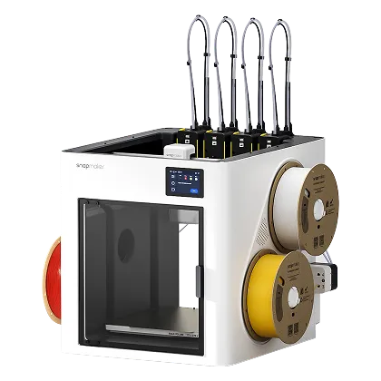
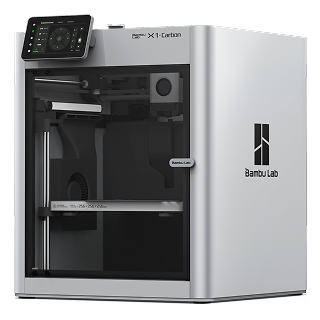
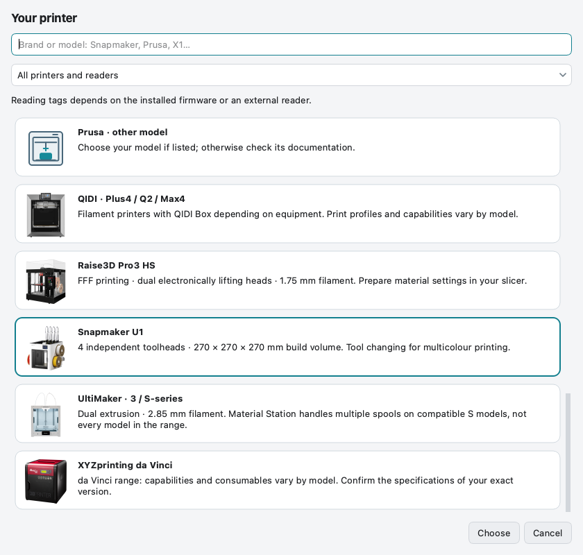

# Printers & readers

[Home](Home.md) · [Get started](Getting-Started.md) · [FAQ](FAQ.md)

**Choose the printer, then its actual reader/software setup.** A USB socket,
a reader powered by USB and a reader supported by the printer are different things.

**[v0.8.0 · Pre-release](https://github.com/ArN-LaB/Spoolscribe-/releases/tag/v0.8.0):** OpenSpool and OpenTag3D are offered only for
identified setups. The public stable v0.3.5 still exports OpenSpool only.

<table>
<tr>
<td width="50%" align="center"> <strong>Snapmaker U1</strong> OpenSpool with compatible paxx12 firmware.</td>
<td width="50%" align="center"> <strong>Bambu Lab X1 Carbon</strong> Native tags use a different format; an external OpenSpool reader is a separate setup.</td>
</tr>
</table>

[See the actual reader/software/tag choices](Visual-Tour.md#3-choose-your-machine-and-its-real-setup).

## Follow the data

| Connection | Required support | What happens |
| --- | --- | --- |
| Built-in reader | A firmware decoder for the tag format | The printer reads the tag directly |
| USB on the printer or host | Matching reader, driver and plugin | The integration decodes and assigns the spool |
| Network scanner | Scanner firmware plus a supported API or automations | Data travels over LAN, not through the scanner’s USB power cable |
| Manufacturer accessory | Exact models, bus and firmware supported by its maker | A CAN accessory is not a universal USB reader |
| USB on your Mac | NFC writing app and supported reader | Writes a tag; does not add reading support to the printer |

## Documented setups

| Printer | Reader and software | SpoolScribe export | Actual effect |
| --- | --- | --- | --- |
| Snapmaker U1 | Built-in, paxx12 **Snapmaker** mode | OpenSpool | Direct reader identification |
| Snapmaker U1 | Built-in, the same paxx12 **OpenRFID** or **OpenRFID Generic** mode | OpenSpool + OpenTag3D | Same formats in both modes; Generic changes brand identification |
| Snapmaker U1 | Network SpoolSense 1.7.5+, paxx12 **External** mode and Moonraker | Both | Sends data to the configured toolhead channel |
| Snapmaker U1 | Documented wasikuss/baze ESP32 remote reader, paxx12 **External** | OpenSpool | These specific readers do not establish OpenTag3D support |
| Flashforge AD5X / Creator 5 | USB ACR122U or PN532 + **Zmod + FF_NFC** | Both | Assigns material/color; plugin required |
| Flashforge AD5X only | USB + **Kiln OS + FF_NFC** | Both | Early integration; complete hardware workflow unverified |
| Flashforge AD5X / Creator 5 | LaneTag network reader + **Zmod + FF_NFC** | Both | Network integration |
| Bambu Lab | ESP32 OpenSpool network reader + permitted LAN/MQTT access | OpenSpool | Sends material/color to the printer; the AMS does not read this tag |
| Bambu Lab | SpoolSense 1.7.0+, TFT, Home Assistant integration, MQTT, Spoolman and automations; LAN Only + Developer Mode | Both | Data sent to the AMS slot; not a USB addition |
| Klipper / Moonraker | Network SpoolSense + configured middleware and macros | Both | Printer integration |
| Klipper / Moonraker | nfc2klipper, documented PN532 UART host setup | None for this path | Spoolman references and experimental old OpenTag3D v0.12; 2.004 unconfirmed |
| Prusa CORE One / L | Official OpenPrintTag accessory, **CAN xBuddy**, firmware **8.0+** | None | Native OpenPrintTag format not exported here; maker excludes INDX/MMU3 |
| Prusa MK4 / MK4S / MMU3 | Network SpoolSense + PrusaLink / Home Assistant | Both, for the scanner | External inventory only, experimental. Does not update filament on the Prusa screen |
| Creality K1 / K1 Max | SpoolSense with original firmware | Both, for the scanner | External inventory only |
| Creality K1 / K1 Max | SpoolSense + rooted/Moonraker setup and middleware | Both | Printer integration after configuration |

**Both** means OpenSpool and OpenTag3D, not every format supported by the reader.
SpoolScribe does not yet encode OpenPrintTag or manufacturer tag formats.
No physical SpoolScribe acceptance is claimed for these additions. The audited
SpoolSense decoder reads our 2.004 data with a minor-version warning; it declares
2.003 support. Do not assume full tag rewriting support from this read test.

## Share a real-world test

The list records documented setups, not certification on every printer. Automated
checks validate the software and exported data. Testing every combination would
require access to every printer, reader and firmware/plugin version; physical
tag writing and printer read-back have not been validated here for these additions.

Successful tests and problems are both welcome through a
[compatibility Issue](https://github.com/ArN-LaB/Spoolscribe-/issues/new?template=printer_compatibility.yml).
Include the exact printer model, reader and connection, firmware/plugin versions,
NTAG type, export format, writing app and observed result. This helps refine the
list and fix problems. Leave out private catalogue files and network credentials.

## Find your actual installation

1. Open **My hardware** and find the printer.
2. Combine the buttons: **reader**, **original/modified/added software**, then
   **installed solution**. A route alone does not confirm that a plugin is installed.
3. Choose an eligible tag format, tag type and writing application.
4. Read the result pinned below the choices. Versions, drivers, prerequisites and
   source links are available under **Requirements and details**.

The browser can filter USB additions, network readers, manufacturer firmware,
modified firmware and formats not exported here. One printer can match several
filters. Manufacturer firmware may still require external hardware or automation.

Previous Bambu + external OpenSpool settings resolve to the Bambu model with that
network reader selected. The old broad Prusa choice requires a model choice;
it is not silently treated as a CORE One with an installed CAN accessory.

Other original RFID ecosystems remain available as reference sheets. An unverified
USB addition does not enable export. An unsupported original format does not mean
all external integrations for that printer are impossible.

## Sources and full requirements

The [configuration guide](https://github.com/ArN-LaB/Spoolscribe-/blob/main/docs/PRINTER-CONFIGURATIONS.md) records the scope,
prerequisites, version limits, legacy settings and primary sources. The
[validation report](https://github.com/ArN-LaB/Spoolscribe-/blob/main/docs/validation/v0.8.0.md) separates software checks from hardware
acceptance. The [hardware catalogue](https://github.com/ArN-LaB/Spoolscribe-/blob/main/data/printers.json) remains at its
public path; older lists keep their historical fields.

- [paxx12 detection systems](https://github.com/paxx12-snapmaker-u1/SnapmakerU1-Extended-Firmware/blob/develop/docs/design/rfid.md).
- [FF_NFC readers and tested platforms](https://github.com/DIEHARDave/FF_NFC).
- [SpoolSense compatibility](https://spoolsense.org/resources/compatibility/) and
  [Prusa integration limits](https://spoolsense.org/installation/prusa/).
- [Prusa accessory models and CAN connection](https://www.prusa3d.com/product/openprinttag-upgrade/).

Images illustrate named models, not every printer in a family. Accessories and
reader support differ. [Image provenance](https://github.com/ArN-LaB/Spoolscribe-/blob/main/data/printers/photos/manifest.json).

[Writing tags](Writing-RFID-Tags.md) · [U1 walkthrough](Snapmaker-U1-and-paxx12.md)
