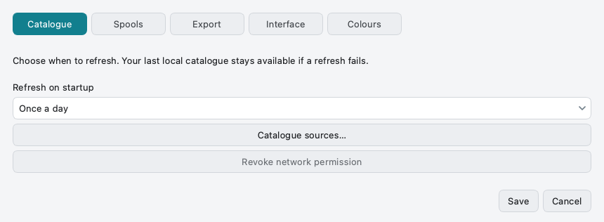
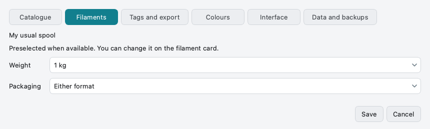
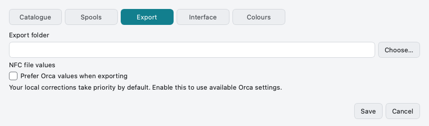
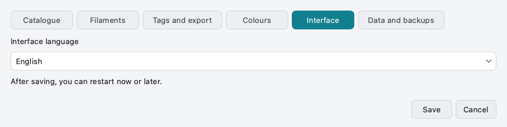
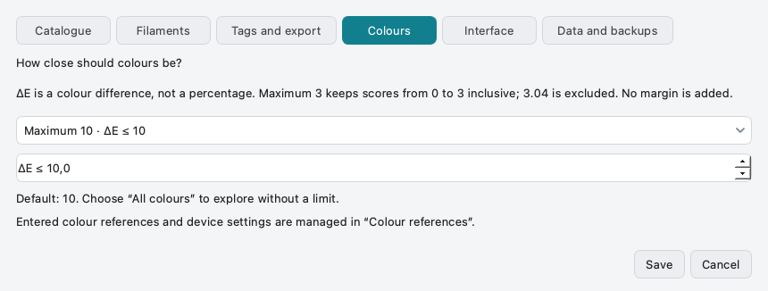
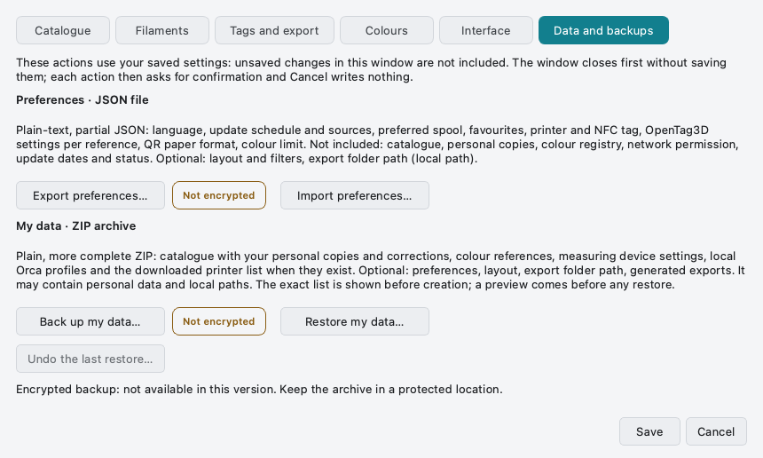

# Application settings

[Help home](Home.md) · [Catalogue updates](Updating-the-Database.md) · [Colour values](Measuring-Colours.md)

Open the main settings menu, then **Settings…**. Six tabs: **Catalogue**,
**Filaments**, **Tags and export**, **Colours**, **Interface** and **Data and
backups**. Make the change and **Save**; **Cancel** discards the fields of this
window. Two catalogue buttons act immediately and are labelled as such:
**Catalogue sources…** and **Withdraw network permission**. Cancelling the
window does not undo them. This six-tab layout is available in Desktop v0.8.1. The screenshots below
are generated from that version using public demonstration data.

## Catalogue: refresh at your pace

Choose the launch refresh cadence: every launch, daily, weekly or manually only.
The cadence is what counts; the older `auto_update` setting is kept for
compatibility and has no effect of its own (`auto_update: false` with a weekly
cadence is valid). A value this window cannot represent is shown as such and kept
until you choose another one. A manual refresh remains available. Network
permission can be withdrawn; the last downloaded catalogue stays local.

  

<strong>Choose the refresh cadence</strong> Source selection and network permission are separate.

## Filaments: preselect a real option

Choose your usual mass and spool/refill preference. The app uses them only when
that actual option exists in the selected record; you can choose another size.

  

<strong>Set the usual spool size</strong> This preference does not invent missing pack sizes.

## Tags and export: keep the destination predictable

Choose the output directory. The export action still asks for its destination.
Downloading the Orca source only makes profiles available. **Prefer Orca values
at export** decides whether an applicable profile replaces catalogue values; when
off, the profile only fills in missing values. **My hardware…** opens the printer,
reader and NFC tag choice; the QR paper format is set in the QR window. Inspect
the effective values (**Origin and reliability** in the filament details) before
writing a tag.

  

<strong>Choose export preferences</strong> The export preview shows the effective values.

## Interface: use your language

**English · French · Spanish · Simplified Chinese**. Automatic follows the system language,
with English as fallback. Save, then choose **Restart now** or **Later**. This
restarts the interface without deleting your data or favourites.

  

<strong>Choose the interface language</strong> A restart applies the saved language.

## Colours: set the maximum distance

Choose a preset or a manual ΔE limit. A small value narrows the results; **All
colours** removes the distance limit. It does not guarantee a matching printed colour.

  

<strong>Set an inclusive ΔE limit</strong> ΔE is a distance, not a percentage.

## Data and backups: two different operations

- **Export/Import preferences…** writes a plain-text JSON file (not encrypted)
  with your preferences and tag settings. It never contains network permission,
  refresh dates or status. Layout/filters and the absolute export-folder path are
  included only when you tick them. Before importing, a preview shows which
  categories are replaced (lists as a whole), which local values are kept and what
  is ignored; changing sources asks for network permission again.
- **Back up/Restore my data…** creates an unencrypted ZIP archive of your data
  (full catalogue with personal copies and corrections, colour references, device
  presets, local Orca profiles, and preferences if chosen). See
  [Backing up your data](Backup-and-Restore.md).

**Export the filament’s OpenSpool JSON…** in the main menu writes one readable
OpenSpool file for the selected filament; it is not a backup.

<strong>Keep preferences and backups distinct</strong> Both exports are local and unencrypted. AES-256-GCM is not implemented.

