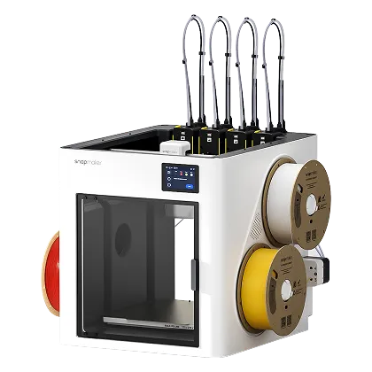

# Snapmaker U1 & paxx12

[Home](Home.md) · [Get started](Getting-Started.md) · [Compatibility](Printers-and-Readers.md) · [FAQ](FAQ.md)

**Prepare OpenSpool or OpenTag3D labels with the matching paxx12 detection mode.**

Available in [v0.5.0 · Pre-release](https://github.com/ArN-LaB/Spoolscribe-/releases/tag/v0.5.0).

<table>
<tr>
<td width="30%" align="center"></td>
<td><strong>Snapmaker U1</strong> Four independent toolheads · 270 × 270 × 270 mm build volume.  The installed firmware determines which tag formats its reader accepts. <a href="https://github.com/paxx12-snapmaker-u1/SnapmakerU1-Extended-Firmware">paxx12 firmware project →</a></td>
</tr>
</table>

## Same printer, different tag support

| U1 configuration | What SpoolScribe can do |
| --- | --- |
| **paxx12, built-in Snapmaker detection** | OpenSpool JSON for NTAG215/216. |
| **The same paxx12, built-in OpenRFID detection** | OpenSpool or OpenTag3D 2.004; select the matching format and writing app. |
| **paxx12, OpenRFID Generic** | The same two formats; Generic changes brand identification, not the encoding. |
| **paxx12, External detection** | A documented network reader/integration is required. Not the same path as the built-in reader. |
| **Stock manufacturer firmware** | A reference sheet; SpoolScribe does not generate native Snapmaker tags. |

The bundled catalogue documents OpenSpool support from paxx12 0.9.4. Follow the
firmware project’s current instructions for the exact installed release.

## From a spool to a recognised filament

| 1. Select | 2. Export | 3. Write & read back | 4. Check on the U1 |
| --- | --- | --- | --- |
| Find the product, colour and actual packaging. | Choose U1, reader and installed solution using the buttons. Select the format and tag, then export. | Use an OpenSpool writer for JSON, or import the OpenTag3D profile into the matching NFC Tools app. | Confirm the detected material and colour against the spool. |

[Writing guide](Writing-RFID-Tags.md) · [All printer configurations](Printers-and-Readers.md)

## What the label does — and what still needs checking

- Material and colour identify the filament for the documented OpenSpool reader.
- Exported fields are not all applied by every firmware. For example, the audited
  Paxx12-24 parser ignores density and exported bed temperatures.
- Keep an appropriate slicer profile. A readable tag does not validate printing settings.
- Physical tag, writer and U1 acceptance remains a separate check; screenshots and
  automated tests do not establish it.

[Successful tests and problems are welcome](https://github.com/ArN-LaB/Spoolscribe-/issues/new?template=printer_compatibility.yml): include the firmware version, detection mode, reader, tag, export format and writing app.

This is a community setup, not official Snapmaker functionality. Firmware changes
belong to the paxx12 project; this guide covers the SpoolScribe side.

<strong>Image and technical references</strong>

[Printer image provenance](https://github.com/ArN-LaB/Spoolscribe-/blob/main/data/printers/photos/manifest.json) ·
[Bundled hardware catalogue](https://github.com/ArN-LaB/Spoolscribe-/blob/main/data/printers.json) ·
[NFC formats and parser references](https://github.com/ArN-LaB/Spoolscribe-/blob/main/docs/FORMATS-NFC.md).

