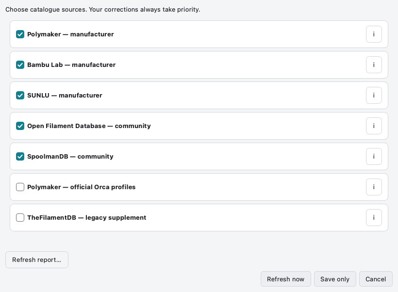
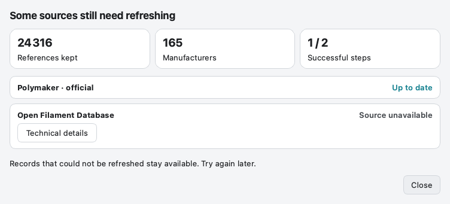
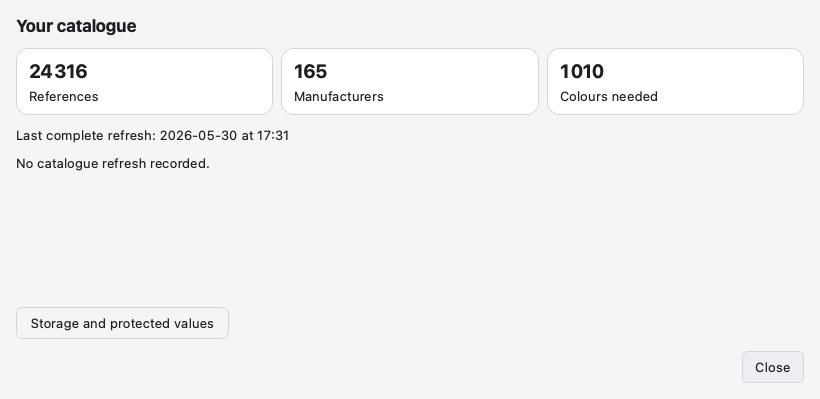

# Refresh the catalogue safely

[Help home](Home.md) · [First download](Getting-Started.md) · [Settings](Settings.md)

## Choose what to contact

Open **Catalogue sources…** and select the sources you want. **Save only** changes
the selection; **Refresh now** starts the network update after permission.
Unchecking a source does not delete its downloaded records.

  

<strong>Choose sources intentionally</strong> Manufacturers take priority; personal corrections remain protected.

A manufacturer source may cover only part of a range. Community catalogues widen
coverage; neither the source list nor the filament catalogue is claimed exhaustive.
The information button shows the role and coverage of a source.

## Understand the result

A partial result can mean one remote source was unavailable while others were
checked successfully. Keep your current data, read the failed source’s message
and try again later. A last attempt is not necessarily a complete update date.

  

<strong>Read a partial-update result</strong> Illustrated example with synthetic statuses; no network download was performed.

**Do not disable certificate verification** to resolve a TLS error. Report the
application version, OS and source name. The bundled app includes its trust roots.

## Check what is stored locally

Click the catalogue status at the bottom of the application. The summary shows
record counts and the last result; storage details are optional. Counts can vary
because product variants are grouped separately from individual source references.

  

<strong>Check the local catalogue</strong> Public demonstration data; counts are not live source coverage.

Refreshes protect personal copies and local corrections. Storage writes keep a
backup and check concurrent changes. Restoration is explicit; a restored database
is not immediately refreshed again in the same session. For a damaged file,
preserve it and report the problem instead of repeatedly reinstalling the app.
To keep a copy of all your data, see [Backing up your data](Backup-and-Restore.md).
