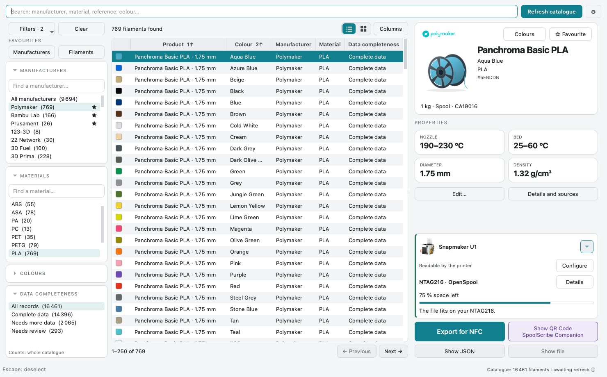
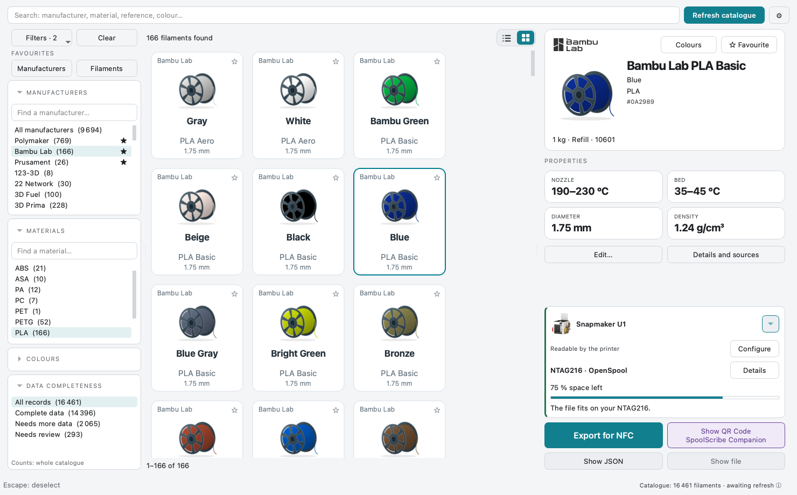
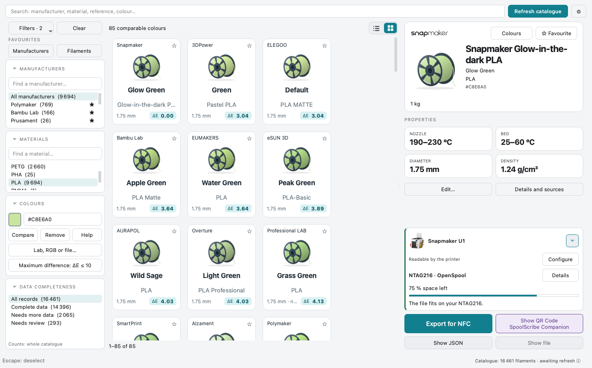
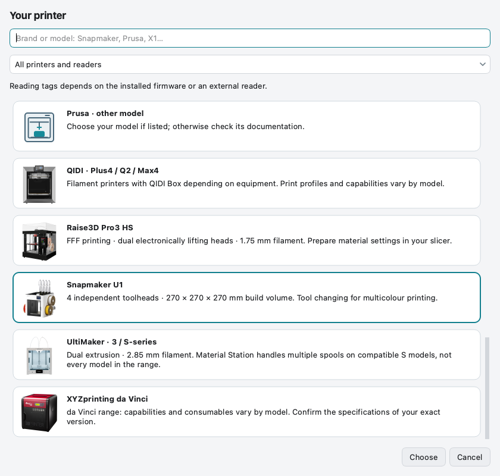
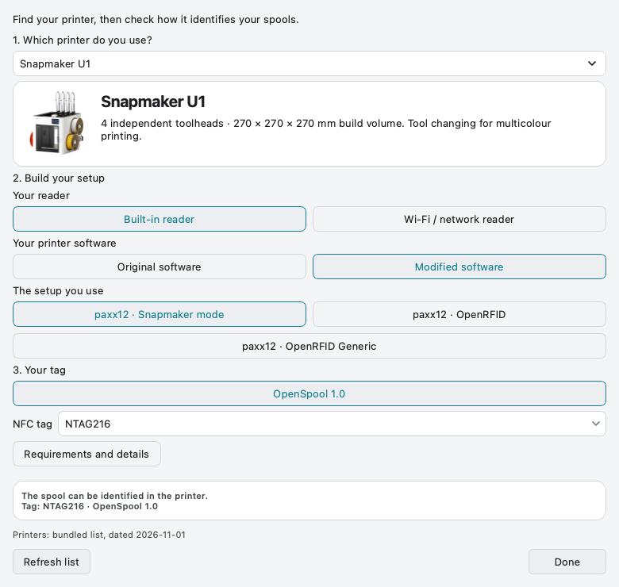
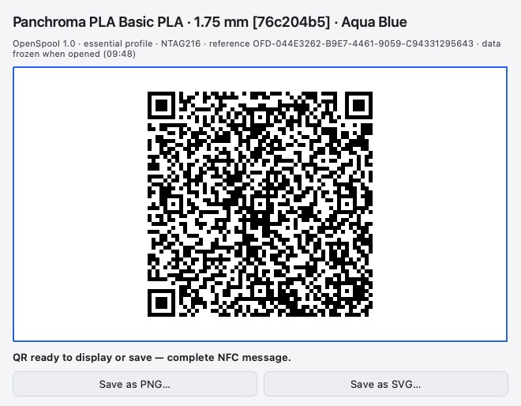

# SpoolScribe v0.8.0 — a visual tour

[Home](Home.md) · [Get started](Getting-Started.md) · [Download pre-release](https://github.com/ArN-LaB/Spoolscribe-/releases/tag/v0.8.0)

**Find a spool → compare its colour → check your reader → prepare the file or QR.**
v0.8.0 adds [colour entry/import and a local registry](Measuring-Colours.md).
The unchanged catalogue, hardware and QR areas are illustrated below with
real v0.8.0 captures with public fixtures, offline settings and no personal
data. Click an image for full size. Demonstration counts are not live coverage.

## 1. Start with the filament

| Look here | What to do |
| --- | --- |
| Left: filters | Choose a manufacturer or material; each narrows the other’s choices. Clear filters without deleting favourites. |
| Centre: catalogue | Search, sort column headers, select a reference or switch to the grid. |
| Right: spool card | Confirm colour and packaging. Edit a protected personal copy if needed. |

**Spool or refill?** Select the actual packaging. Set your usual size in
**Settings → Spools**. A missing value stays unknown; a preview is not a measured
physical colour. [Filters, favourites and personal copies](Getting-Started.md#3-find-your-filament).

## 2. Compare colours with a clear limit

1. In **Colours**, pick a swatch or enter a six-character HEX.
2. Click **Compare**. Existing manufacturer/material filters continue to apply.
3. Read **ΔE** on the cards: a smaller score means closer declared screen colours.
4. Change **Maximum difference** to widen or narrow the search. **Remove** returns
   to ordinary sorting without removing your other filters or favourites.

**ΔE is not a percentage.** A maximum of 3 means `ΔE ≤ 3`, without an extra margin.
A score of 3.04 is therefore excluded at 3 and included at 10. The app rounds the
visible score upwards so the display does not hide a threshold excess.
Multicolour, conflicting, translucent or unknown HEX records are excluded from
comparison; effects such as silk or glow require a visual check. This does not
predict an exact printed colour.

## 3. Choose your machine and its real setup

**Model first.** Search the model or use a category: native, added USB/network
reader, or another documented configuration. A family photo is an illustration;
verify your exact machine and software.

**Then compose the installation you actually use:** reader → software → installed
solution → tag/eligible format. The summary tells you whether the spool can be
identified by the printer, only by external inventory, or is not confirmed.
Hardware and firmware combinations are documented, not exhaustively physically
tested. [Requirements by setup](Printers-and-Readers.md).

## 4. Carry the complete message in a QR

**Show QR Code…** uses the same available export, including its capacity and
missing-data checks. The data is frozen when the window opens. Save **PNG** for a
normal image or **SVG** for a scalable digital file; reopen after changing a spool.

This illustration captures the digital section of the real window; the existing
printing band is outside the picture. **Printing, D101 and physical scanning are
deferred.** The SSQR1 contract is validated digitally for **OpenSpool 1.0** and
**OpenTag3D 2.004**. The future **SpoolScribe Companion** will need to implement
scanning/writing; it does not exist yet. A normal QR scanner only displays transfer
text and cannot program a tag. [Format and safeguards](https://github.com/ArN-LaB/Spoolscribe-/blob/main/docs/QR_FORMAT.md).

## 5. Save, then verify on real equipment

For today's workflow, export the NFC file, choose its destination and use an
appropriate NFC writing app. Read the tag back and check the result on your own
reader. SSQR1 software tests do not certify every physical configuration.
[Writing guide](Writing-RFID-Tags.md) ·
[Share your configuration and result](https://github.com/ArN-LaB/Spoolscribe-/issues/new?template=printer_compatibility.yml).

[Image provenance and regeneration](https://github.com/ArN-LaB/Spoolscribe-/blob/main/docs/images/README.md) ·
[Release validation](https://github.com/ArN-LaB/Spoolscribe-/blob/main/docs/validation/v0.8.0.md).
