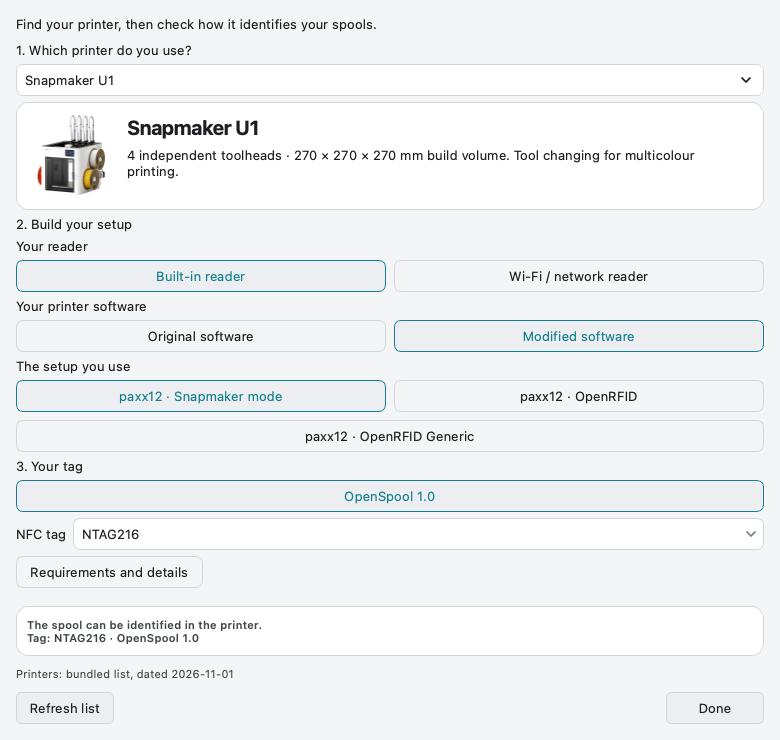
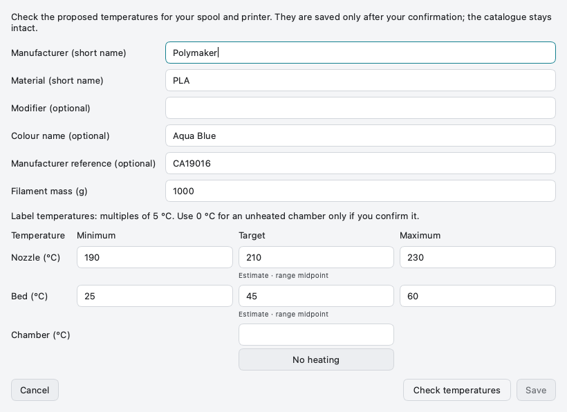
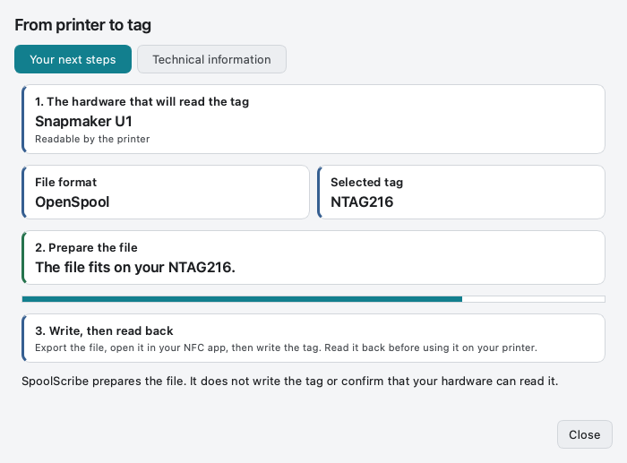

# Prepare and export an NFC label

[Help home](Home.md) · [Printer setup](Printers-and-Readers.md) · [Companion and QR](Companion-and-QR.md)

## 1. Select the real reference and destination

Check the colour and spool size, then choose the reader, installed software,
format and tag type. **NTAG215/216** describes tag capacity; it does not prove
that a printer understands the selected data format.

  

<strong>Match the complete reader setup</strong> The firmware or external integration must accept the chosen format.

## 2. Resolve missing information

OpenSpool needs the selected record’s required identification fields. OpenTag3D
also needs explicit temperature targets. Open **Prepare the label…**, review each
proposal for your spool/printer and confirm next to **Save**.

An Orca U1 target is proposed only for a matching U1 profile; otherwise a known
range can produce a clearly labelled midpoint estimate. Missing chamber heating
is never guessed. **No heating** is an explicit choice. Valid saved settings are
reused by the next export; **Edit** remains available when you need a change.

  

<strong>Review temperature proposals</strong> Suggestions are not confirmed until you validate them.

## 3. Choose the next action

| Your next step | Action |
| --- | --- |
| Use a compatible NFC writing application | **Export for NFC**, then choose the output directory |
| Transfer to the future mobile Companion | **Show QR Code — SpoolScribe Companion** |
| Inspect the data first | **Show JSON** for OpenSpool, **Show export** for OpenTag3D |
| Locate the saved result | **Show file** after a successful export |

OpenSpool exports UTF-8 JSON. The standard Desktop OpenTag3D path exports the
raw NDEF message; choose another writing app only if it supports that exact file
and record format. Legacy file containers remain a CLI compatibility feature.
No third-party writing application is preferred over Companion.

  

<strong>Check readiness and capacity</strong> Available space applies to the selected format and tag.

## 4. Write, read back, then try the reader

Desktop prepares the file; it does not write the physical chip. Use a compatible
writer or Companion when available, read the tag back and check it on your actual
reader. A successful file export is not proof that a printer accepted the tag.

If capacity is insufficient, reduce optional OpenSpool metadata or choose a larger
tag if the reader supports it. Keep any writer-specific space reservation required
by that writer. A zero reservation does not prove no additional bytes will be added.

[QR help](Companion-and-QR.md) · [OpenTag3D details](https://github.com/ArN-LaB/Spoolscribe-/blob/main/docs/OPENTAG3D.md)
